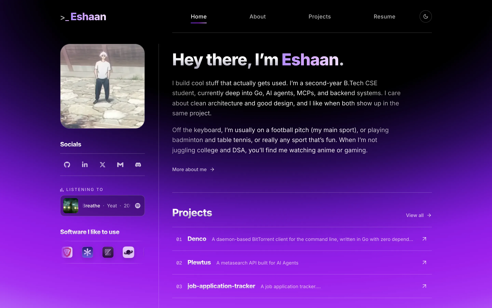
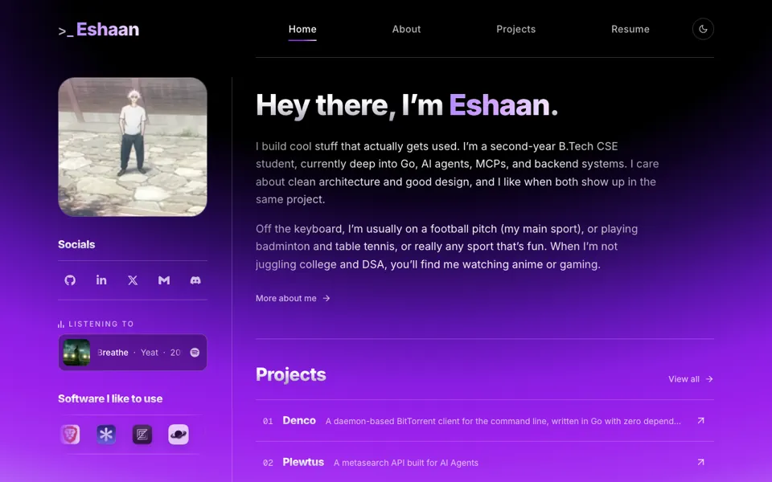
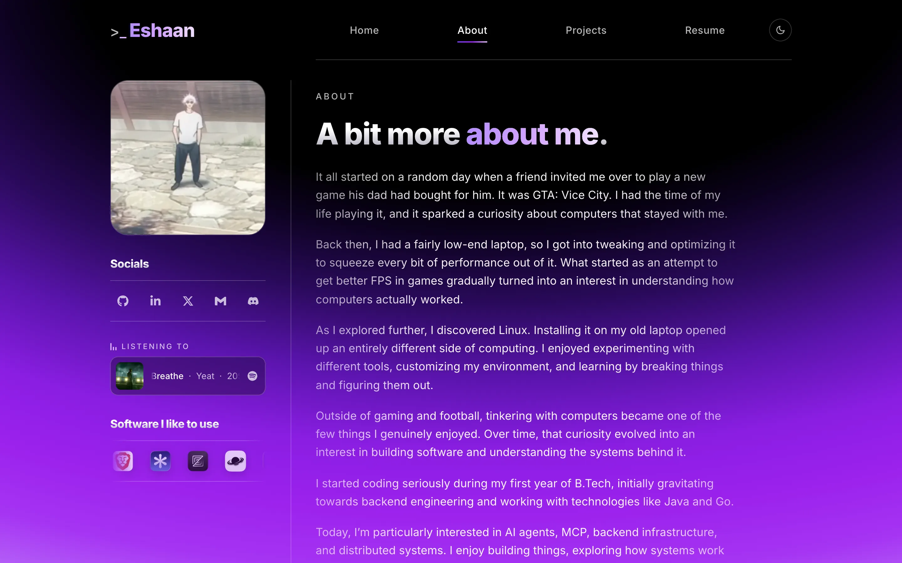
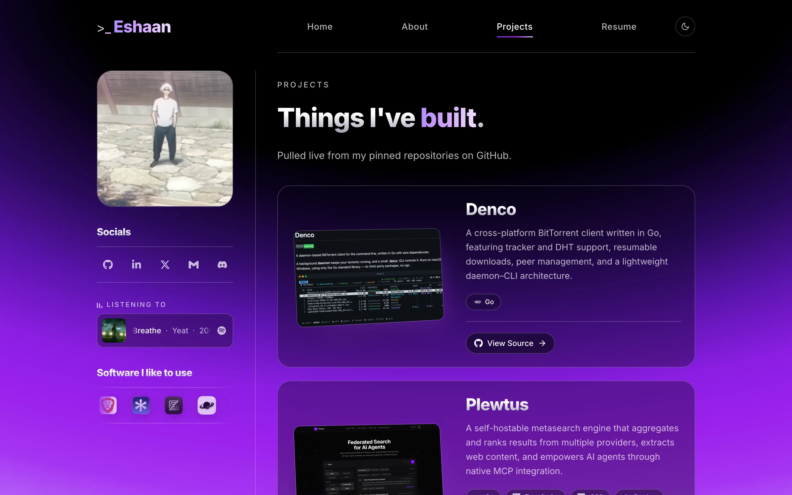
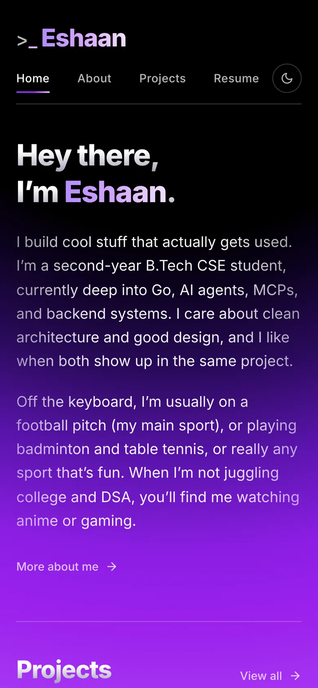

<div align="center">

<picture>
  <source media="(prefers-color-scheme: dark)" srcset=".github/assets/home-dark.webp">
  <source media="(prefers-color-scheme: light)" srcset=".github/assets/home-light.webp">
  
</picture>

<h1>&gt;_ Eshaan</h1>

<p><b>My personal portfolio: a quiet black dome that melts into purple.</b><br>
Live projects from GitHub, a theme switch that pours in along the gradient, and not much else in the way.</p>

<!-- Add the live link here once deployed, e.g.:
<p><a href="https://your-domain.dev"><b>Visit the site →</b></a></p>
-->

<p>
  
  
  
  
  
</p>

</div>

<br>

## The theme switch

<p align="center">
  
</p>

The new theme doesn't just swap in. It pours down from the top of the page, following the same dome shape as the background gradient, with a soft edge. Built with the View Transitions API and an animated CSS mask, it works in Chromium and Safari and switches instantly if you prefer reduced motion.

## Highlights

- **Live projects.** Pinned repositories are fetched from GitHub on the server and cached for an hour. A GraphQL → profile page → REST fallback chain keeps them showing even without a token.
- **Pinned frame.** On desktop the navbar and sidebar stay put and only the content moves, while the window still does the scrolling, so the wheel, keyboard and back button behave normally.
- **Quiet scrollbar.** A slim gradient thumb that appears while you scroll and fades away when you stop.
- **Sheen headings.** White-to-silver gradient type in Inter ExtraBold, with gradient borders and wipe animations on hover.
- **Little details.** A blinking `>_` prompt, a now-playing card and a software belt that scroll on their own, and project cards with tilted screenshots that straighten on hover.
- **No flash, no fuss.** The saved theme is applied before the first paint; everything respects `prefers-reduced-motion`.

## Pages

<table>
  <tr>
    <td width="50%">
      <picture>
        <source media="(prefers-color-scheme: dark)" srcset=".github/assets/about-dark.webp">
        <source media="(prefers-color-scheme: light)" srcset=".github/assets/about-light.webp">
        
      </picture>
      <p align="center"><b>About</b></p>
    </td>
    <td width="50%">
      <picture>
        <source media="(prefers-color-scheme: dark)" srcset=".github/assets/projects-dark.webp">
        <source media="(prefers-color-scheme: light)" srcset=".github/assets/projects-light.webp">
        
      </picture>
      <p align="center"><b>Projects</b></p>
    </td>
  </tr>
</table>

<p align="center">
  <picture>
    <source media="(prefers-color-scheme: dark)" srcset=".github/assets/mobile-dark.webp">
    <source media="(prefers-color-scheme: light)" srcset=".github/assets/mobile-light.webp">
    
  </picture>
  <br><sub>…and on a phone</sub>
</p>

## Run it

```bash
npm install
npm run dev     # http://localhost:3000
```

```bash
npm run build && npm start
```

Optionally, add a `GITHUB_TOKEN` (no scopes needed) to `.env.local` for the exact pinned-repo order and higher rate limits:

```bash
GITHUB_TOKEN=ghp_your_token_here
```

## Make it yours

Nearly everything personal lives in one file, [`src/lib/site.ts`](src/lib/site.ts):

| What | Where |
| --- | --- |
| Name, role, home and About text | `site` |
| GitHub username and how many projects to show | `site.githubUsername`, `site.projectLimit` |
| Social links | `site.socials` |
| Now playing card | `site.listening` |
| Software belt | `site.apps` (icons in `public/apps`) |
| Project titles, descriptions, screenshots | `projectDetails` (images in `public/projects`) |
| Tech stack on the About page | `techStack` |

Colours and gradients are CSS variables at the top of [`src/app/globals.css`](src/app/globals.css).

## Under the hood

```
src/
├── app/            routes (home, about, projects, resume), layout and global styles
├── components/     navbar, sidebar, project views, theme toggle, scroll indicator
└── lib/
    ├── site.ts     all the personal content
    └── github.ts   pinned-repo fetching with caching and fallbacks
public/             profile picture, app icons, project screenshots
.github/assets/     images used in this README
```

## Licence

[MIT](LICENSE). Borrow the code freely; the personal content and photos are mine.

<div align="center">
<br>
<a href="https://github.com/7Eshaan">GitHub</a> ·
<a href="https://www.linkedin.com/in/eshaan-dogra">LinkedIn</a> ·
<a href="https://x.com/eshawwn">X</a>
</div>
